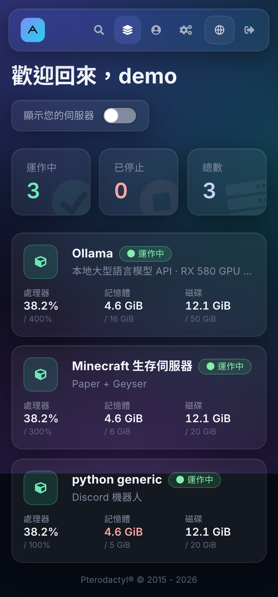
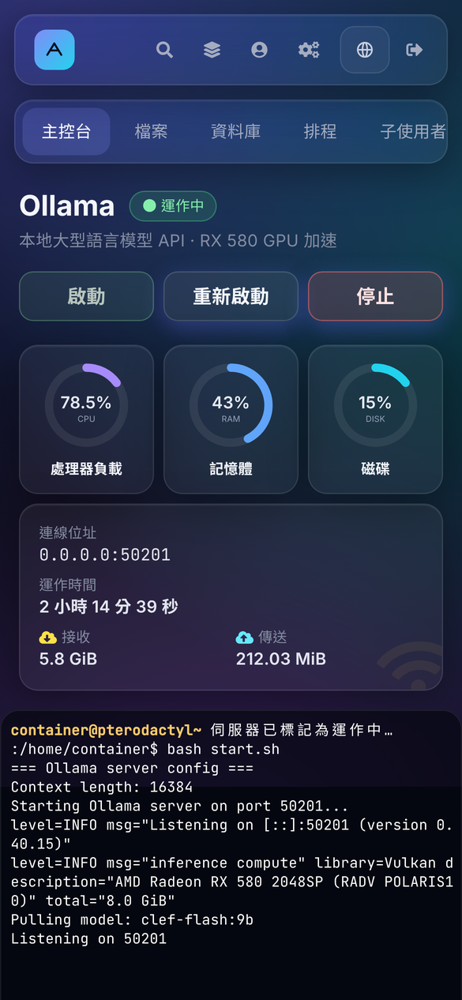
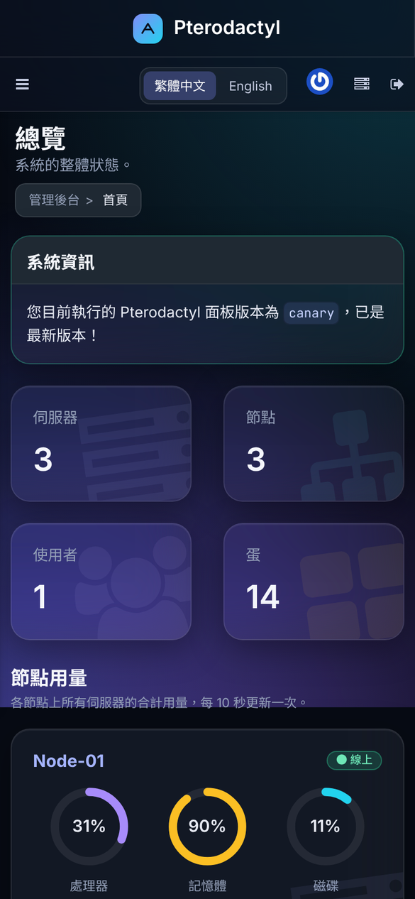

# Pterodactyl Style ZH

深色毛玻璃主題 + 完整繁體中文，適用 **Pterodactyl Panel 1.15.2**。

使用者介面、管理後台、系統郵件、活動紀錄、錯誤訊息都已翻譯，並可隨時切換回 English。前端已預先編譯，伺服器**不需要安裝 Node.js**。

[English](#english)

| 伺服器列表 | 主控台 |
| --- | --- |
|  |  |
| **登入頁** | **管理後台總覽** |
|  |  |

<p align="center">
  
  
  
</p>

## 特色

- **深色毛玻璃外觀**：圓形用量儀表、即時波形圖、浮水印圖示、頁面切換動畫
- **繁體中文 / English**：頂部列、登入頁、帳戶設定、管理後台都能切換，選擇會記在帳號上，郵件也會使用同一個語言
- **手機版最佳化**：使用者介面與管理後台都針對手機排版
- **管理後台總覽**：統計卡，以及每個節點的處理器、記憶體、磁碟用量
- **伺服器圖示**：依照伺服器使用的蛋自動選擇（Minecraft、GPU / AI、遊戲、資料庫、網站、程式）
- **自訂名稱與標誌**：在「系統設定」直接修改，標誌會套用到頂部列、登入頁、郵件與瀏覽器分頁圖示
- **淺色系統郵件**：重設密碼、帳戶建立、伺服器安裝完成等郵件都有新設計
- **可完整還原**：安裝前自動備份，一行指令即可還原成原本的面板

## 安裝

> 需求：Pterodactyl Panel **1.15.2**、可使用 `sudo` 的帳號。其他版本安裝腳本會先詢問是否繼續，但不保證相容。

1. 建議先備份資料庫：
   ```bash
   mysqldump -u root -p panel > ~/panel-db-backup.sql
   ```
2. 下載並安裝：
   ```bash
   cd ~ && curl -L https://github.com/clre20/pterodactyl-style-zh/releases/latest/download/pterodactyl-style-zh.tar.gz | tar xz
   sudo bash pterodactyl-style-zh/install.sh /var/www/pterodactyl
   ```
   - 會被覆蓋的檔案會先備份成 `pterodactyl-backup-日期時間.tar.gz`，放在面板資料夾的上一層
   - 最後會詢問是否把繁體中文設為所有使用者的預設語言
3. 瀏覽器按 `Ctrl + F5` 重新整理

## 更新

再執行一次上面的下載與安裝指令即可。腳本會偵測到先前的安裝，**保留第一次安裝時的原始備份**，只另外備份這次才會修改的原始檔案，所以還原指令不變。

## 還原

安裝完成時畫面會顯示還原指令，格式如下：

```bash
sudo bash ~/pterodactyl-style-zh/restore.sh /var/www/pterodactyl-backup-日期時間.tar.gz /var/www/pterodactyl
```

## 自訂名稱與標誌

都在管理後台 →「系統設定」修改：

- **名稱**：「公司名稱」欄位，按「儲存」
- **標誌**：「標誌」區塊選擇圖片並按「上傳」（PNG / JPG / WebP，建議正方形、至少 128×128、2 MB 以內）。按「恢復預設標誌」即可移除
- **郵件寄件者名稱**：「系統設定」→「郵件」分頁

> 如果「系統設定」頁面上方顯示「面板目前設定為只從環境設定檔讀取設定」，需要在 `.env` 加上 `APP_ENVIRONMENT_ONLY=false` 才能從頁面修改名稱。

## 注意事項

- **升級 Pterodactyl 前請先還原。** 面板升級會覆蓋這些修改；升級後請確認本主題是否已支援新版本。
- 主題的樣式與程式檔網址會自動加上版本，使用 Cloudflare 時不需要手動清除快取。
- 字型由 Google Fonts 載入；如果伺服器所在網路連不到 Google，會自動改用系統字型（微軟正黑體 / 蘋方）。
- 蛋（Egg）的變數名稱與說明是蛋作者寫的內容，不在翻譯範圍內，可以在「巢組」→ 蛋 →「變數」自行修改。

## 修改的檔案

| 路徑 | 內容 |
| --- | --- |
| `app/` | 語言切換 API、節點用量、標誌上傳、郵件語言 |
| `resources/views/` | 管理後台與郵件樣板 |
| `resources/lang/zh*` | 後端翻譯 |
| `resources/scripts/` | 前端原始碼（含 `locales/zh.json` 介面翻譯） |
| `routes/` | 新增的路由 |
| `public/assets/` | 已編譯的前端 |
| `public/themes/pterodactyl/` | 管理後台樣式 `glass.css` 與翻譯過的腳本 |

### 自行編譯前端

如果修改了 `files/resources/scripts/`，把 `files/` 的內容複製到一份 1.15.2 的面板原始碼，然後依照官方的 [Building Panel Assets](https://pterodactyl.io/community/customization/panel.html) 執行：

```bash
yarn install
yarn build:production
```

再把產生的 `public/assets/` 放回 `files/public/assets/`。

## 授權與致謝

- 以 [MIT License](LICENSE) 授權。
- 本專案修改自 [Pterodactyl Panel](https://github.com/pterodactyl/panel)（MIT License，© Dane Everitt and contributors）。Pterodactyl® 是其所有者的商標，本專案與 Pterodactyl 官方無關。
- 主題作者：[clre20](https://github.com/clre20)

---

## English

A dark glassmorphism theme with a complete **Traditional Chinese (zh-TW)** translation for **Pterodactyl Panel 1.15.2**. The client area, admin area, emails, activity log and error messages are translated, and users can switch between 繁體中文 and English at any time. Frontend assets are prebuilt, so Node.js is not required on the server.

**Install**

```bash
cd ~ && curl -L https://github.com/clre20/pterodactyl-style-zh/releases/latest/download/pterodactyl-style-zh.tar.gz | tar xz
sudo bash pterodactyl-style-zh/install.sh /var/www/pterodactyl
```

The installer backs up every file it replaces and prints a restore command when it finishes. Run the same commands again to update. Restore before upgrading Pterodactyl.

Panel name and logo can be changed under **Admin → Settings**.

Licensed under the MIT License. Based on Pterodactyl Panel (MIT). Not affiliated with the Pterodactyl project.
