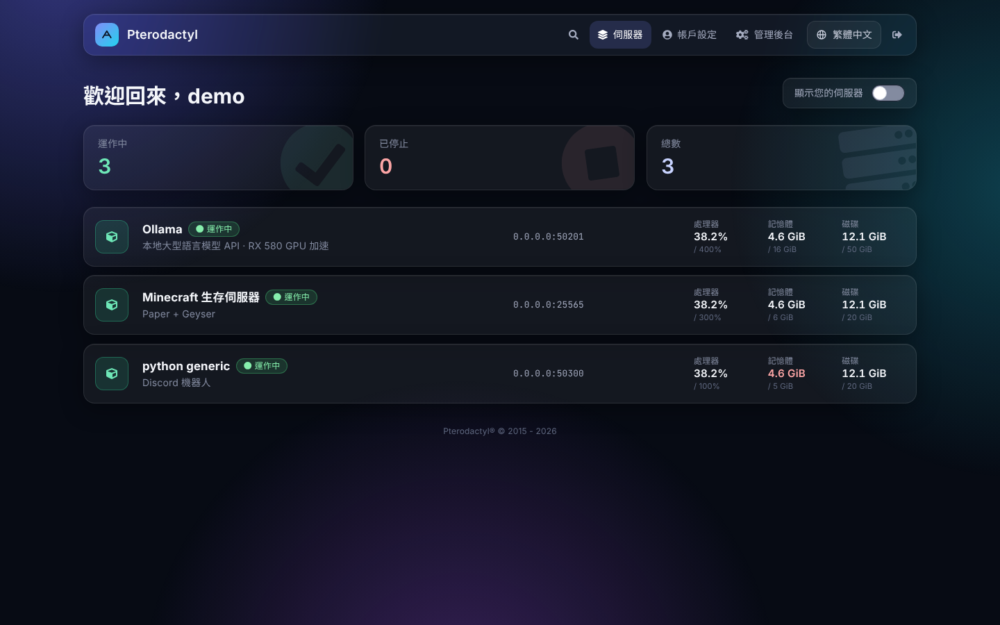
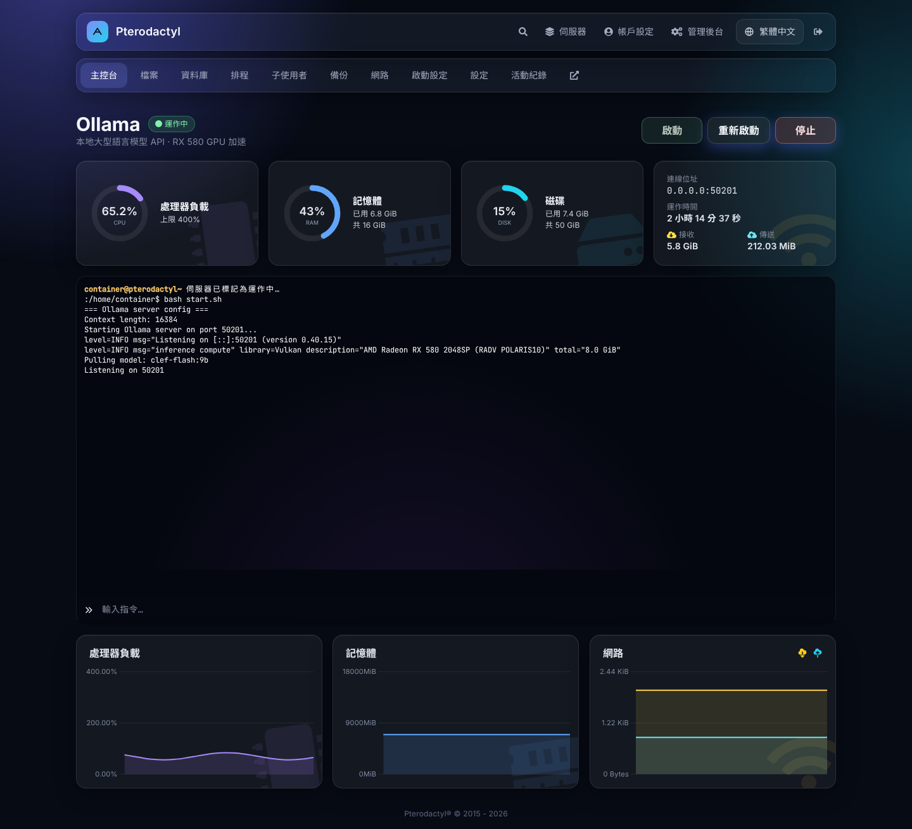
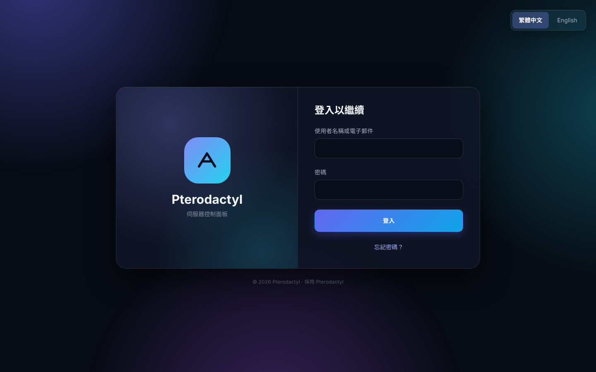
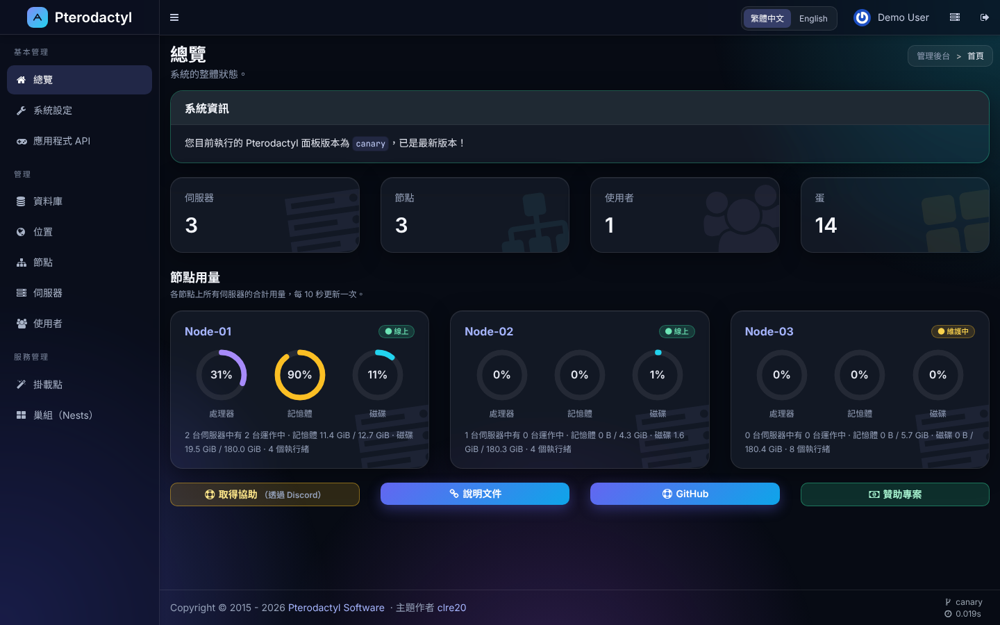

# Pterodactyl Style ZH

深色毛玻璃主題 + 完整繁體中文，適用 **Pterodactyl Panel 1.15.2**。

使用者介面、管理後台、系統郵件、活動紀錄、錯誤訊息都已翻譯，並可隨時切換回 English。前端已預先編譯，伺服器**不需要安裝 Node.js**。

[English](#english)

| 伺服器列表 | 主控台 |
| --- | --- |
|  |  |
| **登入頁** | **管理後台總覽** |
|  |  |

## 特色

- **深色毛玻璃外觀**：圓形用量儀表、即時波形圖、浮水印圖示、頁面切換動畫
- **繁體中文 / English**：頂部列、登入頁、帳戶設定、管理後台都能切換，選擇會記在帳號上，郵件也會使用同一個語言
- **手機版最佳化**：使用者介面與管理後台都針對手機排版
- **管理後台總覽**：統計卡，以及每個節點的處理器、記憶體、磁碟用量
- **伺服器圖示**：依照伺服器使用的蛋自動選擇（Minecraft、GPU / AI、遊戲、資料庫、網站、程式）
- **伺服器列表工具**：釘選常用伺服器、依節點分組、清單／卡片兩種檢視、即時篩選；每台伺服器附即時走勢線，可各自切換顯示處理器、記憶體或網路（上傳與下載各一條線）
- **主控台工具**：快速指令按鈕、指令歷史、搜尋輸出、錯誤與警告自動上色、下載紀錄、清除畫面
- **Minecraft 分頁**：線上玩家與踢出、白名單／管理員／封鎖名單管理（伺服器停止時也能修改）、以表單或文字編輯 `server.properties`（只在 Minecraft 伺服器顯示）
- **外觀設定**：在「系統設定 → 外觀」修改主題色、標誌、頁面與登入頁背景、副標題、頁尾文字，不必重新編譯
- **蛋的伺服器圖示**：在蛋的設定頁輸入 Font Awesome 免費圖示名稱，使用該蛋的伺服器都會顯示這個圖示
- **公告橫幅**：站長在後台輸入公告，顯示在使用者介面每一頁的最上方
- **載入與空白畫面**：骨架載入、空白狀態插圖、全新的錯誤頁（404、403、500、維護中等）
- **狀態動態**：運作中的伺服器有呼吸光點，啟動與停止時有進度光條，卡片依伺服器類型上色
- **淺色系統郵件**：重設密碼、帳戶建立、伺服器安裝完成等郵件都有新設計
- **可完整還原**：安裝前自動備份，一行指令即可還原成原本的面板

## 安裝

> 需求：Pterodactyl Panel **1.15.2**、可使用 `sudo` 的帳號。其他版本安裝腳本會先詢問是否繼續，但不保證相容。

1. 建議先備份資料庫：
   ```bash
   mysqldump -u root -p panel > ~/panel-db-backup.sql
   ```
2. 下載並安裝：
   ```bash
   cd ~ && curl -L https://github.com/clre20/pterodactyl-style-zh/releases/latest/download/pterodactyl-style-zh.tar.gz | tar xz
   sudo bash pterodactyl-style-zh/install.sh /var/www/pterodactyl
   ```
   - 會被覆蓋的檔案會先備份成 `pterodactyl-backup-日期時間.tar.gz`，放在面板資料夾的上一層
   - 最後會詢問是否把繁體中文設為所有使用者的預設語言
3. 瀏覽器按 `Ctrl + F5` 重新整理

## 更新

再執行一次上面的下載與安裝指令即可。腳本會偵測到先前的安裝，**保留第一次安裝時的原始備份**，只另外備份這次才會修改的原始檔案，所以還原指令不變。

## 還原

安裝完成時畫面會顯示還原指令，格式如下：

```bash
sudo bash ~/pterodactyl-style-zh/restore.sh /var/www/pterodactyl-backup-日期時間.tar.gz /var/www/pterodactyl
```

## 自訂外觀

- **名稱**：管理後台 →「系統設定」→「一般」的「公司名稱」欄位
- **郵件寄件者名稱**：「系統設定」→「郵件」分頁
- 其餘都在「系統設定」→「**外觀**」分頁：

| 項目 | 說明 |
| --- | --- |
| 標誌 | PNG / JPG / WebP，建議正方形、至少 128×128、2 MB 以內。套用到頂部列、登入頁、管理後台、郵件與瀏覽器分頁圖示 |
| 主題色 | 6 組預設配色，或自選主要與次要顏色。按鈕、連結、背景光暈、郵件按鈕都會跟著變 |
| 登入頁副標題 | 面板名稱下方的文字，留空使用預設的「伺服器控制面板」 |
| 頁尾文字 | 顯示在登入頁與使用者介面底部，留空則不顯示 |
| 公告 | 可選一般資訊、好消息、警告、緊急四種樣式；使用者可自行關閉，內容更新後會再次顯示 |
| 頁面背景 | 使用者介面與管理後台所有頁面的背景圖，最多 8 張。未上傳時使用預設的漸層光暈，顏色跟著主題色 |
| 登入頁背景 | PNG / JPG / WebP，建議橫向、至少 1600×900、4 MB 以內，會自動調暗，最多 8 張 |
| 背景切換 | 有多張背景時，可選「每次造訪隨機一張」或「輪播」（可設定間隔秒數，淡入淡出切換） |

> 如果「系統設定」頁面上方顯示「面板目前設定為只從環境設定檔讀取設定」，需要在 `.env` 加上 `APP_ENVIRONMENT_ONLY=false` 才能從頁面修改名稱。「外觀」分頁的設定不受這個限制。

### 伺服器圖示

管理後台 →「巢組」→ 選一個蛋 →「伺服器圖示」。輸入 [Font Awesome Free](https://fontawesome.com/search?o=r&m=free) 的圖示名稱（例如 `cube`、`dragon`、`fa-brands fa-discord`），或直接貼上該網站複製的程式碼，也可以另外指定顏色。留空則由面板依蛋的內容自動選擇。

## 注意事項

- **Minecraft 線上玩家**是由面板主機直接連到遊戲連接埠查詢的。面板主機連不到遊戲連接埠時（防火牆、內網位址），人數不會顯示，其餘功能不受影響。伺服器運作中時，名單是透過主控台指令修改；停止時則直接寫入名單檔案，此時新增正版玩家需要面板主機能連到 `api.mojang.com` 查詢 UUID。
- 釘選的伺服器、檢視方式、走勢線顯示項目與快速指令儲存在各自的瀏覽器中，換裝置需要重新設定。
- **升級 Pterodactyl 前請先還原。** 面板升級會覆蓋這些修改；升級後請確認本主題是否已支援新版本。
- 主題的樣式與程式檔網址會自動加上版本，使用 Cloudflare 時不需要手動清除快取。
- 字型（Inter、Noto Sans TC、JetBrains Mono）與 Font Awesome Free 圖示字型已內建在主題中，不會連到 Google 或其他外部網站。
- 蛋（Egg）的變數名稱與說明是蛋作者寫的內容。官方內建的蛋與常見的通用語言蛋（Python、Node.js、Java 等）已內建中文對照，顯示時自動翻譯，不會更動資料庫；其餘的蛋可以在「巢組」→ 蛋 →「變數」自行修改。

## 修改的檔案

| 路徑 | 內容 |
| --- | --- |
| `app/` | 語言切換 API、節點用量、外觀設定、Minecraft 狀態查詢、郵件語言 |
| `resources/views/` | 管理後台與郵件樣板 |
| `resources/lang/zh*` | 後端翻譯 |
| `resources/scripts/` | 前端原始碼（含 `locales/zh.json` 介面翻譯） |
| `routes/` | 新增的路由 |
| `public/assets/` | 已編譯的前端 |
| `public/themes/pterodactyl/` | 管理後台樣式 `glass.css` 與翻譯過的腳本 |

### 自行編譯前端

如果修改了 `files/resources/scripts/`，把 `files/` 的內容複製到一份 1.15.2 的面板原始碼，然後依照官方的 [Building Panel Assets](https://pterodactyl.io/community/customization/panel.html) 執行：

```bash
yarn install
yarn build:production
```

再把產生的 `public/assets/` 放回 `files/public/assets/`。

## 授權與致謝

- 以 [MIT License](LICENSE) 授權。
- 本專案修改自 [Pterodactyl Panel](https://github.com/pterodactyl/panel)（MIT License，© Dane Everitt and contributors）。Pterodactyl® 是其所有者的商標，本專案與 Pterodactyl 官方無關。
- 主題作者：[clre20](https://github.com/clre20)

---

## English

A dark glassmorphism theme with a complete **Traditional Chinese (zh-TW)** translation for **Pterodactyl Panel 1.15.2**. The client area, admin area, emails, activity log and error messages are translated, and users can switch between 繁體中文 and English at any time. Frontend assets are prebuilt, so Node.js is not required on the server.

**Install**

```bash
cd ~ && curl -L https://github.com/clre20/pterodactyl-style-zh/releases/latest/download/pterodactyl-style-zh.tar.gz | tar xz
sudo bash pterodactyl-style-zh/install.sh /var/www/pterodactyl
```

The installer backs up every file it replaces and prints a restore command when it finishes. Run the same commands again to update. Restore before upgrading Pterodactyl.

Panel name and logo can be changed under **Admin → Settings**.

Licensed under the MIT License. Based on Pterodactyl Panel (MIT). Not affiliated with the Pterodactyl project.
